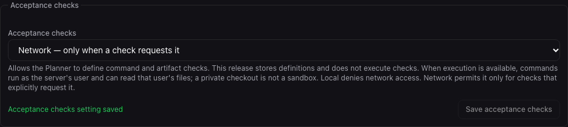

# Acceptance checks: types and protocol validation

This stage stores Planner-authored check definitions and an operator-only project
permission. It executes no check. The executor, evidence storage/read API,
private checkout/write protection, limits and restart recovery follow in PR 2;
evidence gates and `recheck` follow after that.

## Automated validation

Tests were written before implementation. Focused protocol tests cover missing,
unknown and invalid keys, limits, criterion references, artifact/protected paths,
network permission, work-only checks and PLAN/replan/add_steps. PostgreSQL tests
cover restart/edit round trips, additive migration/readmission, permission
persistence, export/import and operator/client authorization. Imports may set this
permission only with operator identity; an omitted permission preserves the
target, including when a client imports a legacy or disabled export.

Enabled plan edits replace check definitions (omission clears them); while off,
a replan must omit `checks` and preserves the stored definitions. Plan views echo
existing definitions. Restore validates stored checks against the current project
permission inside the saved-plan read handler: incompatible or corrupt definitions
are logged and the plan is not loaded, leaving the database untouched. Default-off
plans without definitions still restore normally. Planner prompt previews use the
project's permission; off retains the original contract and preview notes.

`acceptance_checks.update` declares high risk and confirmation, with an impact
summary describing the project, selected mode and future file/network access.
Operator calls still execute once, matching `delivery_guard.update`; client tokens
remain forbidden. The existing dashboard save confirmation needs no change.

The review follow-up ran seven touched test files with two workers on disposable
PostgreSQL: 492 tests passed, including main-byte plan-view comparisons and bridge
upgrades after synchronizing the migration registry. No real-model call was made
for this follow-up; the real protocol results below predate these fixes.

The default-off fixture pins public main revision
`bc0e118d404b464bf7dcf6fbfbb42c2f031864a3`. Its 13 SHA-256 comparisons cover the
complete Planner contract/system prompt, PLAN and four DECISION messages,
Worker/Reviewer system prompts and initial messages, and step serialization.
A provenance test regenerates it with `git show`. Four database cases execute
main's original INSERT and the new INSERT in one transaction, comparing the
bytes of every historical column, including generated timestamps. The only
additional physical field is `checks = []`, omitted from public output.

## Real Claude protocol comparison

The exact Planner prompt builder and reply parser were exercised with the real
Claude CLI on a synthetic report task with three measurable criteria. No model
tools were available and no check command ran. The off prompt uses the main
protocol proved identical above; the enabled prompt adds only the example and
paragraph from RFC section 6, verbatim.

| Model | Mode | Repetitions | Valid plans | Checks bound to criteria |
|---|---|---:|---:|---|
| Sonnet | off | 2 | 2/2 | 0, 0 |
| Sonnet | local | 2 | 2/2 | 3/3, 3/3 |
| Opus | off | 1 | 1/1 | 0 |
| Opus | local | 1 | 1/1 | 3/3 |

All six responses passed the production protocol parser without a repair turn.
This is a focused protocol comparison, not an execution/evidence evaluation;
the RFC's full task matrix belongs to the later execution stages.

## Dashboard and real service

A source `looper serve` used a fresh disposable PostgreSQL database, temporary
runtime root and separate loopback port. Channel integrations were disabled.
Headless Chromium saved off/local/network, reloaded the stored value, checked
that switching off omits the field from the existing project response, and
verified a failed save keeps the draft and shows the error. Checks covered
1280, 768, 390 and 844-pixel widths, no horizontal overflow, keyboard navigation
and reduced motion. The persistent chat stream prevents global network-idle;
the browser waits for the actual settings controls and save response instead.

The new control explains the permission and current lack of execution. It uses
the existing fieldset, select and Button styles. Existing project fields keep
their save path; the permission has a separate operator-only save. Task pages,
Telegram and Lark gain no evidence output in this stage. CLI clients can use the
same dedicated v1 operations with operator authentication; model tool lists are
unchanged.

Independent Claude review prompted additional coverage of the import permission
boundary, database-to-Planner setting refresh, new-project import, and keeping
the save confirmation visible after the project list refreshes. All four were
verified before handover.
