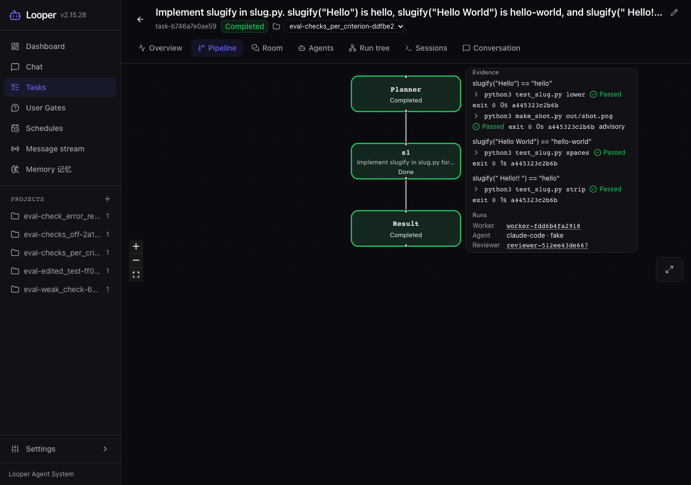
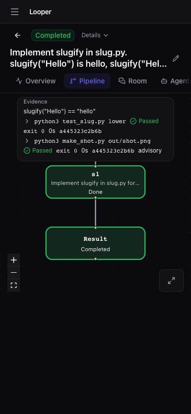
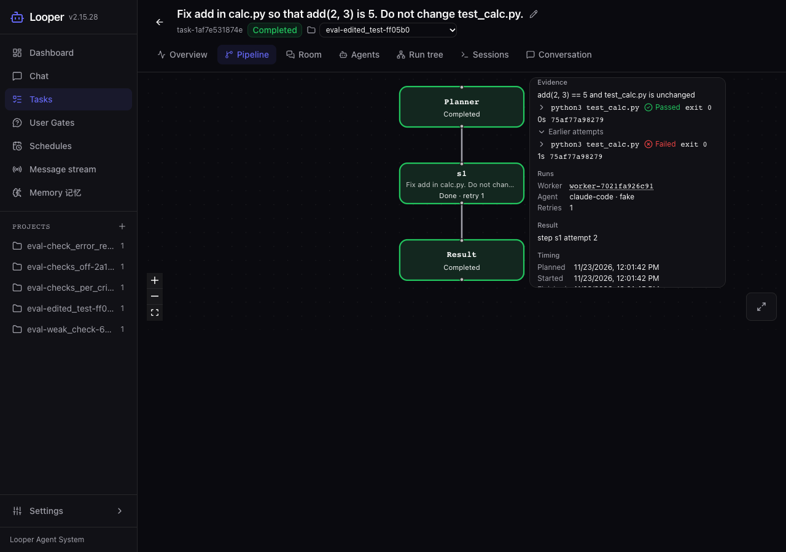
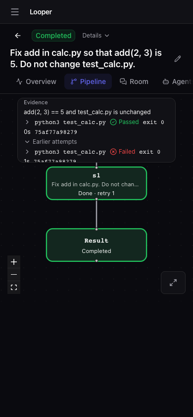
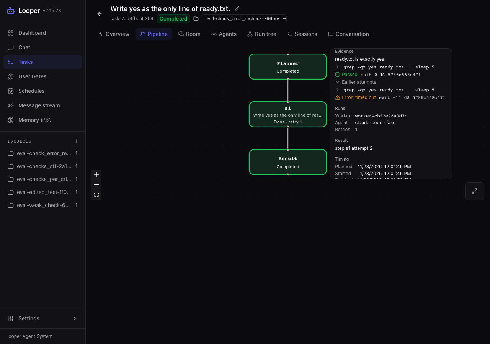
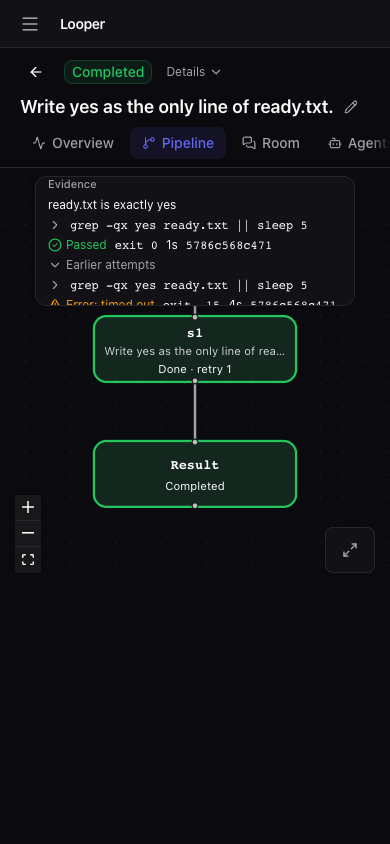

# Acceptance eval: fake-mode readback

This record is one fake-mode run of the `acceptance` task set and one of the
existing `hard` set. The stand-in played every role. No model was called.
Result-section readback is pending PR 5: that result evidence is not on this
base, so this record does not claim a `## Evidence` block on the result.

The harness was `python -m evals.prompt_regression run --mode fake`. Acceptance
finished 5/5 at 0.0360 USD. Hard finished 3/3 at 0.0120 USD, each case 1/1 with
zero retries. `checks_off` leaves acceptance checks off, so its row has no
acceptance metric keys (a missing count is zero for `max_checks_defined`).

| task | checks defined | criteria checked | trivial | protected changed | rechecks | breaches | review fails | artifacts | reviews with evidence |
|---|---:|---:|---:|---:|---:|---:|---:|---:|---:|
| checks_per_criterion | 4 | 3 | 0 | 0 | 0 | 0 | 0 | 1 | 1 |
| checks_off | — | — | — | — | — | — | — | — | — |
| weak_check | 1 | 1 | 1 | 0 | 0 | 0 | 1 | 0 | 2 |
| edited_test | 1 | 1 | 0 | 1 | 0 | 0 | 0 | 0 | 0 |
| check_error_recheck | 1 | 1 | 0 | 0 | 1 | 0 | 0 | 0 | 0 |

## Retry feedback

`edited_test` attempt 1 rewrote `test_calc.py` and left `calc.py` wrong. The
check exited 0 with an empty tail and `protected_changed: ["test_calc.py"]`.
Attempt 2 restored the seeded test, fixed `calc.py`, and passed with an empty
protected list.

The retry text is in the second Worker's system prompt, in the task section.
The user input does not contain it. The prompt starts:

```text
Failed required acceptance checks:
  criterion 1: "add(2, 3) == 5 and test_calc.py is unchanged" — c1 FAILED (exit 0)
  Command: python3 test_calc.py
```

There is no `source="acceptance_output"` fence. The fence wraps a non-empty
output tail, and this failure produced none. The recorded failure is the
protected path.

## Reviewer evidence

On `checks_per_criterion` the Reviewer system prompt contains
`## Acceptance evidence (measured by Looper at a445323c2b6b, not by you)` and
`lower command: PASSED`. The four checks (three required `python3 test_slug.py`
modes and one advisory `python3 make_shot.py out/shot.png`) passed on attempt 1.
The step used zero rechecks.

The advisory check stored one artifact: name `1.png`, mime `image/png`, 70
bytes, sha256 `c414cd0e204de974f73753c7e28d7638e7b3691bb8b1a2bab6b25bb7fed7ce77`.


## Error then recheck

`check_error_recheck` ran `grep -qx yes ready.txt || sleep 5` with a two-second
timeout. Attempt 1 left `ready.txt` as `no`, so the check ended `error` /
`timeout` twice. The Planner answered `recheck` once while that decision was
allowed, then `retry`. Attempt 2 wrote `yes` and the check passed. The step
result records `rechecks_used: 1`. Evidence breaches stay 0.

## Checks left off

`checks_off` uses the same slug requirement and a plan with no `checks`. The
step's acceptance field is empty, `task_evidence.get` has no runs, and no
artifact was stored.

## Weak check

`weak_check` binds criterion 1 to the required command `true`. Both attempts
passed that command. The Reviewer failed attempt 1 (`review_fails` 1) and the
second attempt was accepted. Evidence breaches stay 0 because the current
required check is `passed`.

## Dashboard

A throwaway local `looper serve` used a fresh database, a temporary runtime
root and a loopback port other than 8767. Headless Chromium opened each task's
pipeline, hovered the `s1` step, and saved the step card at 1280 and 390 px.
The page did not scroll horizontally. The evidence block is inside the step
card.












