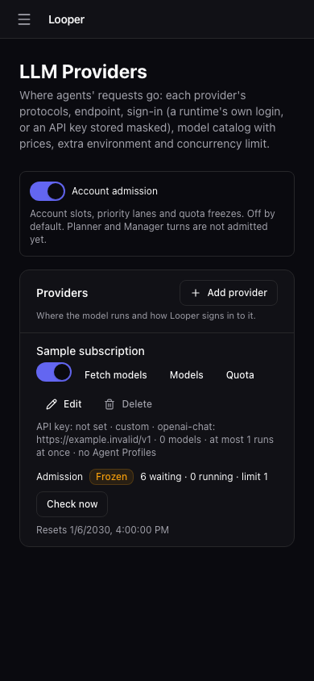

# 账号准入核心验证

`engine.admission.enabled` 默认关闭，需先开启失败分型。启用后，Worker、Reviewer、consult、processor、advisor / judge / outbound 子运行在 recorder 和预算预留之前申请账号槽位；备用 Profile 换账号时重新准入。Planner / Manager 回合和平台 Explorer 留待后续接线。

账号上限使用 `llm_providers.max_concurrency`，NULL 不限；同账号按共享 `Lane`、等待老化及先来顺序放行。任何有效窗口达到 95% 时暂停后台车道；额度失败冻结账号，到期只放行最长等待者探测。运行中的任务不被打断。子运行继承父车道并借用运行中父槽，保留运行接管时重新登记，排空期间不放行。等待账号准入、尚未启动的 Worker 不计入排空阻塞；取消排空后可以继续。

## 验证路径

- 固定基线 `6e1ff9cb86d2975c8b4ef34ca3a3504d91004fc4` 的关闭路径记录在 `tests/fixtures/admission_off.json`；覆盖四类启动命令、提示词、记录写入和 `providers.limits`。关闭路径测试还检查任务槽位等待/唤醒与零准入存储读取。
- 调度器测试覆盖优先级、5 分钟老化、2 分钟交互保护、NULL 上限、借槽、排空、接管登记、冻结状态转换、5→60 分钟退避、恢复持久状态、开关热关闭、95% 边界、内部错误放行与旧运行信号不能解冻。Codex 同一事件包含 rejected 窗口时不能作为 allowed 信号；PROBING 同样检查运行开始时间。探测持有者在恢复前取消会释放所有权；Codex 钩子在后台执行，5 秒超时回退到等待者探测，其他账号不受阻塞，过期结果不能覆盖新状态。
- PostgreSQL 测试覆盖迁移对象修复、事务事件/状态写入、空库 baseline marker、清理、操作权限和失败分型关闭时的配置拒绝。
- `tests/test_admission_serve_db.py` 启动一次性服务及新数据库，仅用合成 CLI 和假渠道 adapter：一个 429 冻结账号，三个 Worker 排队；加速时钟越过 `until`，只运行一个探测，成功后继续串行放行；下一次冻结由 `providers.limits_clear` 清除。通知经过真实 `ChannelRegistry.notify` 签名，发往替身聊天，任务活动和 API 状态由存储读回。通知独立于记录关闭预算，发送失败或取消会释放 claim，重试沿用 `idempotency_key`；停机在关闭渠道和数据库前等待后台任务清理。
- `tests/test_admission_hooks_db.py` 从 consult、processor、spawn 和接管入口验证排队、记录时机与账号容量；分别移除三处准入钩子及接管登记后，四个测试均失败。
- 前端测试覆盖开关独立确认、冻结状态、等待/运行/上限、未知重置、检查确认与失败状态。浏览器截图仅含合成账号。

## 本次结果

本轮评审修复使用 Python 3.11、两个 pytest worker 和一次性 PostgreSQL，验证 18 个文件共 **785 个用例**，包含 API、工具级别、迁移、关闭基线、存储和隔离服务。首轮 784 通过、1 个既有 keeper fencing 测试触发 5 秒总预算超时；该 Worker 文件独立重跑 **39 项全部通过**，未放宽超时。最终版状态机和隔离服务亦已复验。前端三个相关 Vitest 文件 **103 项通过**；本轮未改界面。

三个阻塞点的回归均先在修复前复现失败；同步通知发送的变异也会使记录关闭测试超时。新增约 108 行生产代码、710 行测试代码（含修改过的测试行）；测试篇幅主要用于真实入口、数据库与取消清理的行为验证，避免宽松替身掩盖接线错误。

此前的生产构建和 Playwright 验证使用合成账号，检查 390px 手机、768px 平板、1280px 桌面及 844×390 横屏，均无横向溢出；确认“Check now”后从 Frozen 切到 Open。重置时间展示排除了准入额外等待的 60 秒。临时服务、浏览器及数据库均在验证后清理。

## 尚未验证

真实额度耗尽/重置不能安全制造，未测试；未调用真实模型。Codex 的只读 `account/rateLimits/read` 仍是未验证能力：准入使用小型类型化探测钩子，默认 `Unavailable`，然后放行最长等待者。单测覆盖 `Allowed`、`StillLimited`、`Unavailable` 三种结果。

成本守卫和账号准入使用独立开关。成本守卫的用量窗口模块尚不在本分支基线，95% 常量暂在准入模块定义；后续合入该模块时共用常量。交互超额放行的日计数是进程内诊断值，重启后重新计数。
