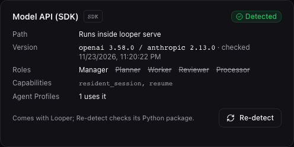

# Messages 编解码器本地验收

本记录只覆盖 API runtime 阶段 2.1 的协议能力。全部请求发给 loopback 脚本化 HTTP 服务；没有发送真实供应商请求、调用真实模型、向外部渠道发消息或切换已有 Profile。阶段 2.2 的供应商准入仍待安排。

## 实现与 SDK 核对

使用 Python 3.11.15、实际安装的 `anthropic 2.13.0`、`openai 3.58.0` 和 SDK 传输层 `httpx2 2.16.2`。依赖范围为 `anthropic>=2.3,<3`，只在 Messages 请求时导入 SDK。

- `AsyncAnthropic(auth_token=..., base_url=..., max_retries=2)` 使用 Bearer，真实请求无 `x-api-key`，不继承代理或隐式凭据。SDK 自带 `/v1/messages` 路径；HTTP hook 将目标固定为已解析 endpoint 的 `/messages`，兼容含版本和自定义前缀的 endpoint。
- 本次 SDK 的 `OutputConfigParam.effort` 接受 `low/medium/high/xhigh/max`，`ThinkingConfigAdaptiveParam` 接受 `{"type":"adaptive"}`。有 effort 时发送 `output_config` 与上述 `thinking`；缺 effort 或 Messages 模型目录 `efforts=[]` 时都不发送。这里只证明 SDK 类型与本地 wire，不证明供应商接受这些参数。
- system 最后一块和最后消息的最后内容块各有一个 ephemeral 标记；不制造空块。完整中性历史编码为 text、tool_use、tool_result；工具说明与 schema 不变。
- 合法 `message_stop` 前不执行工具；截断、重复 id、非法索引、未知结构、流中错误和缺终态均不提交半批工具。非法 JSON 对象不猜测修复；被严格拒绝的参数以字符串保留，通过现有工具校验返回错误。这样的非法历史不能编码为下一次合法对象请求，后续明确返回 `INVALID_REQUEST`，不会执行操作或回退。
- thinking 摘要与签名分开。最小原生块以版本 1 replay payload 保存，只在相同协议及模型回传；记录、显示及错误不含签名/redacted 正文。
- 输入、缓存读、缓存写独立保留；output 使用累计快照。缺桶保留未知，缺最终 output 快照不视为完整用量。失败及停止保留已知 token，费用为未知。
- 使用现有中性循环的一次断流重发、30 次 HTTP 尝试预算、停止补齐和平台工具确认；没有新工具、操作、迁移或设置。

## 本地验证

Python 测试均使用 3.11、两个 xdist worker；数据库用独占 disposable PostgreSQL。对应测试集合：

| 验证批次 | 结果 |
|---|---|
| Messages wire 与 Responses 固定基线 | 60 passed |
| Runtime/Profile/注册表 | 69 passed |
| 会话、渠道、真实 CLI serve、v1 文档与工具分级 | 476 passed |
| 既有 Responses、循环、停止、用量、上下文、transcript、v1 文档与工具分级 | 610 项均通过；其中旧循环能力断言更新后单独复跑 36 passed |

上述批次有共同测试，不能直接相加。没有将数据库 skip 算作通过。

```sh
uv run --system-certs --python 3.11 --extra test python -m pytest -q -n 2 \
  tests/test_api_messages.py tests/test_api_responses.py tests/test_api_loop.py \
  tests/test_api_runtime_kind.py tests/test_api_runtime_registry_db.py \
  tests/test_api_sessions_db.py tests/test_api_entry_points_db.py \
  tests/test_api_messages_serve_db.py tests/test_api_stop_db.py \
  tests/test_api_usage_records_db.py tests/test_api_context_switch_db.py \
  tests/test_api_transcript_db.py tests/test_api_v1_document.py tests/test_tool_levels.py
```

真实 `looper serve` 在独立端口、临时 HOME/runtime root 和 fresh PG 上经 v1 注册合成 provider、model、Manager Profile。HTTP 聊天验证文本、平台工具、确认取消、失效确认拒绝、确认执行、停止断连、跨进程重启同会话续接和 `/new` 清理；Runs 与数据库读回协议、请求 id、费用及停止的不完整用量。CLI discovery 使用拒绝执行的替身，外部渠道禁用。Telegram/Lark 通过现有 adapter 替身验证 `/profile` 和 `/stop`。

固定基线 fixture 来源为 `5f03d2929d14d21c6cc69ec053e0230370829f44`。分别冻结 Responses 请求、完整历史、命令、系统拼接、工具返回、事件、用量、取消和续接；旧 CLI 的启动方法逐项固定 SHA，另录六种 CLI 的实际 launch args。没有整模块摘要或移动 ref。Responses 正向 HTTP 对照证明捕获器仍接到请求；Responses-only 测试禁止创建 Messages codec。

前端两份既有组件测试共 94 项通过，`npm run build` 通过（现有 chunk size 提示）。无产品网页代码改动。真实隔离服务的 Profile 编辑器可选 Messages/API，Worker 选择器拒绝该 Profile；缺 SDK 的后端探测分支与界面错误分别验证。浏览器检查 1280、768、390、844 宽度；下面只保留一张不含凭据或路径的截图。



## 继承的限制

现有 `ApiSession` 在首次 HTTP 请求前创建会话元数据，失败且无条目时清理；完成后的条目批次原子追加，删除后的会话不能被追加复活。因此本次验证了无半批历史、失败清理与 drop 竞态，但**没有满足 RFC §7.1 的首次元数据和条目同事务**。本次没有修改共享 session、数据库或 Responses 的初始化行为；该既有差异需单独收敛，不能用绿色协议测试代替事务证明。

## 待授权的真实模型验证

没有运行付费评测。阶段 2.2 需要分别准备同一 `deepseek-v4-pro` 模型的 API 与 Claude Code Profile spec：API 使用 `anthropic-messages`，CLI 对照使用 `claude-code`，key 只从 `LOOPER_EVAL_API_KEY` 读取。建议先运行 `status,confirm_create_start,cancel_confirmation,stop_then_continue`，每个重复 2 次，各对照预算上限 $4；通过后全部对话各重复 2 次，每侧暂估不超过 $30（合计预算上限 $60，需要执行前批准，非实际费用预测）。

```sh
# 两个 spec 均由操作者按供应商实际 endpoint 登记，不使用本地假服务结果代替。
uv run --extra test python -m evals.prompt_regression dialogs --mode real --model sonnet \
  --manager-agent "$MESSAGES_CLI_SPEC" --reps 2 --jobs 2 \
  --max-budget-usd 1 --case-budget-usd 1 --total-cap-usd 30 \
  --pg-url "$LOOPER_EVAL_DATABASE_URL"
uv run --extra test python -m evals.prompt_regression dialogs --mode real --model sonnet \
  --manager-agent "$MESSAGES_API_SPEC" --baseline "$CLI_RUN_JSON" --reps 2 --jobs 2 \
  --max-budget-usd 1 --case-budget-usd 1 --total-cap-usd 30 \
  --pg-url "$LOOPER_EVAL_DATABASE_URL"
```

需要核实 Bearer、缓存标记、thinking/effort、签名重放和真实用量分桶；按 RFC D11 比较每个对话与全部确认类结果。本地 HTTP 通过不构成 DeepSeek、GLM、Kimi、OpenCode 的准入结论。
