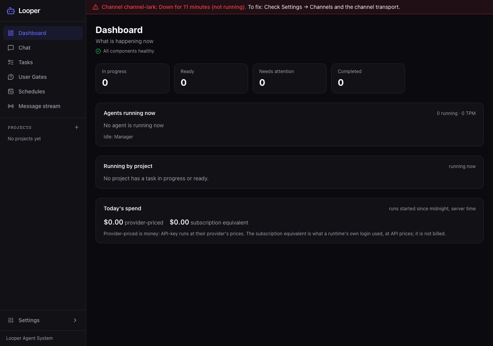
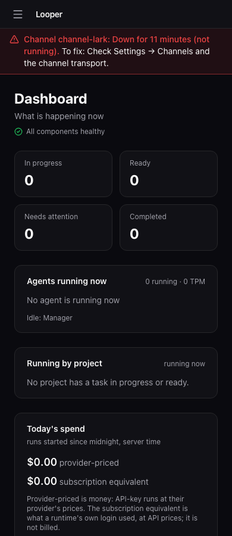

# Channel outage alerts

An enabled channel that stays down for more than the configured threshold
appears in the existing dashboard top banner and sends one notice through
each other enabled, healthy bot with an operator id. Recovery clears the
banner and sends one recovery notice through those alternate paths.

Validation uses synthetic bot identities and local transport substitutes;
no external messages or model calls are made.

Results: 417 distinct Python tests passed across the touched/new files. One
group passed 52; another initially passed 363 with two existing 30-second
startup timeouts, and both timed-out cases passed on an isolated rerun without
code changes. The 12 outage regressions passed again after the final state
persistence change. Frontend validation passed 71 tests and the production
build; Ruff and whitespace checks passed for the follow-up files.

- PostgreSQL regression cases cover an 11-minute Lark outage, one alternate
  Telegram alert, restart deduplication, recovery, a second outage, a single
  enabled channel, missing operator ids, disabling/re-enabling, and successful
  sends resetting failure intervals across notification and receipt sources.
- The isolated `looper serve` path uses a fresh database, temporary runtime
  root and ephemeral HTTP port. Authenticated system status exposes and clears
  the problem while the real Telegram notification adapter sends to a local
  synthetic bot and the Lark adapter retries and recovers.
- Frontend tests cover healthy empty markup, discovering a new outage without
  reloading, recovery and cancellation of polling on unmount.
- Headless Chromium verifies 1280, 768, 390 and 844 px widths, no horizontal
  overflow or browser errors, and recovery without reloading. Screenshots
  below use synthetic system status through intercepted API responses.

The backend and dashboard each poll every 30 seconds. External alert attempts
are bounded and recorded before sending: a failed or interrupted attempt is
not retried during the same outage. The full test suite and real platform
delivery are outside this local validation.
