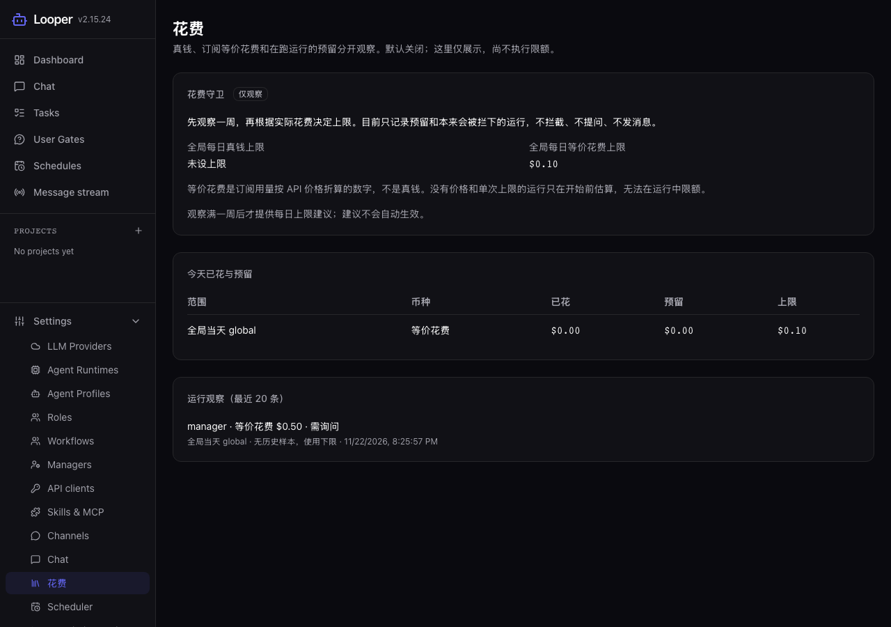
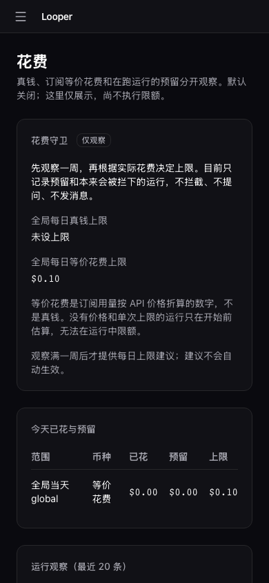

# Cost guard observation validation

This stage implements the cost guard RFC's first PR: estimates, reservations,
shared day boundaries, observation at every model-run entry point and a read-only
operator view. Enforcement and notifications remain separate work.

- The review-fix targeted Python run passed **433 tests** with two xdist workers on
  a disposable PostgreSQL database. It included all four new cost guard test
  files, `test_api_v1_document.py` and `test_tool_levels.py`; no full suite or CI
  run was triggered. The database was dropped after validation.
- Three frontend tests passed; the frontend production build passed. Vite emitted
  its bundle-size advisory.
- `looper serve` ran with a fresh database, a temporary runtime root, a separate
  port and synthetic runtime executables. Operator HTTP readback verified unset
  caps and off by default, switching to observe, an actual Manager recorder's
  reservation, a would-ask observation and settlement to its reported cost.
  No real model or external channel was called.
- Chromium checked the actual page at 1280, 768, 390 and 844 pixels, with no
  horizontal page overflow or page errors. The unrelated live chat stream was
  ended by a browser fixture to allow network-idle readiness. The cost view and
  its API used the real isolated server.
- The first smoke harness invocation used an invalid package entry point; the
  next reached the server but timed out waiting for its permanent chat stream
  to become idle. Both harness issues were corrected without product changes;
  the completed smoke above passed.
- The off-path provenance tests load the actual `ClaudeRunRecorder` class from
  main revision `4b602aeed` and compare the complete stored start payload bytes
  for Manager, Planner and processor launches, including command and system
  prompt metadata. Those production files are unchanged in the later main
  revision `b773ef7bd` integrated before opening this PR.
- This stage requires no migration. The branch includes main's per-file
  migration registry from #1527; it adds no schema or migration changes.

Accounting failures in observe mode log a problem and let the outbound
classifier run, including when the first rebuild fails repeatedly. Only an
allow verdict with a successful audit permits the action; failure to persist
an existing review reservation still blocks classification. Schedule daily-cap
observations combine both currencies to match the existing scheduler cap;
global daily caps remain separate. Schedule profile loading runs outside the
admission lock.

Remaining observation limitations: finishing an unreserved run updates counters
on the next rebuild; schedule-only observations without a model record survive
only in logs across restart; Manager ASK observations do not implement the
operator-turn exception planned for enforcement. History rebuilds still hold
the admission lock.

The page shows mode and explicit caps first, separates real spend from
subscription equivalents, and keeps running reservations beside actual spend.
The recent observations retain estimate provenance and their simulated action;
no editable control or approval button is introduced in this stage.





## Pending real-model validation

No real-model validation was executed. Prompts, tools, command construction,
process signature inputs, retries and in-run caps are unchanged; the provenance
and scripted-runtime checks are not real-model evidence.

If approved, run these representative existing cases against disposable
installations, first off and then with observe seeded through the operator-only
cost guard API before cases start:

```sh
uv run --extra test python -m evals.prompt_regression run --mode real \
  --model sonnet --reps 2 --tasks parallel_parts,reviewed_step,room_consult \
  --jobs 2 --max-budget-usd 1 --case-budget-usd 2 --total-cap-usd 12
uv run --extra test python -m evals.prompt_regression dialogs --mode real \
  --model sonnet --reps 2 --dialogs status,confirm_create_start \
  --jobs 2 --max-budget-usd 1 --case-budget-usd 1 --total-cap-usd 4
```

Proposed cases: six task repetitions and four dialog repetitions per mode.
Estimated spend: $4–12 per mode ($8–24 for both), with aggregate observed-spend
caps of $16 per mode ($32 total), not hard provider billing limits. Compare with
the recorded Sonnet baselines and inspect reservation/readback visibility.
The existing runner needs an operator-settings seed hook for the observe leg;
that hook and both paid runs are pending approval, not claimed as implemented
or validated here. No CI run is triggered by this proposal.
