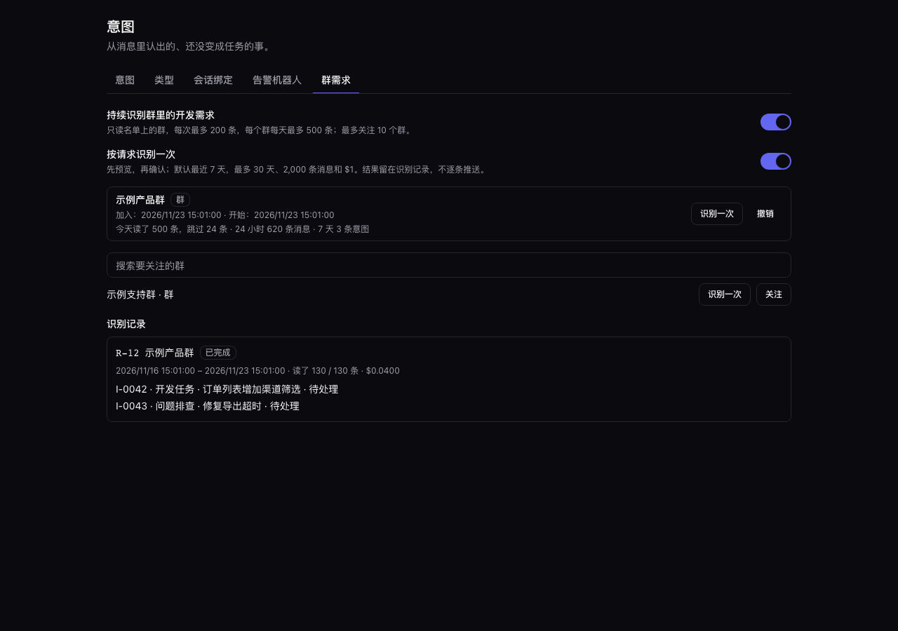

# 群需求：识别一次的验证

独立开关 `intents.on_request.enabled` 默认关闭；本改动以持续识别的实现为基线。

## 已验证

- Python 3.11，定向 pytest 全部使用 `-n 2` 和一次性 PostgreSQL：
  - `test_intent_recognition_db.py`：范围、live/history、前文、同时间戳的最新 2,000 条、剩余预算、失败保留、停止与恢复、单条私聊结果；名单、每日计数和游标不变。
  - `test_intents_recognize_tool_db.py`、`test_intents_api_db.py`：操作者身份、群聊/API 客户端拒绝、确认冻结范围、接口形状、开关。
  - `test_intents_default_off.py`、`test_extraction_default_off.py`、两份 extraction/group-read golden：关闭时目录、提示内容和进程签名不变。
  - `test_extraction.py`、`test_extraction_db.py`、`test_intent_push_db.py`：共享抽取与推送回归。
  - `test_api_v1_document.py`、`test_tool_levels.py`、`test_schema_migration_registry_db.py`：操作目录、权限级别、迁移升级；`test_model_eval_registration.py`：评测注册。
- `test_intents_group_serve_db.py` 使用实际 `looper serve`、独立数据库与运行目录、桥接 NDJSON、HTTP 和离线 CLI/渠道替身。对另一个群先预览再启动，仅识别一条 live 消息（排除初始 import）；读取完成记录、关联的 on_request 意图和处理器调用记录。等待推送轮询真正处理该行后，确认没有逐条通知；名单和订阅游标不变。
- `web/src/pages/intents.test.tsx`：13 项通过；`tsc -b` 与 lint 通过（仓库已有 warning）。合成数据浏览器检查 1280×900、768×900、390×844、844×390，以及有数据、空、关闭、错误状态；取消恢复焦点，确认前无启动调用，无页面错误或横向溢出。
- `git diff --check` 和新增后端文件的 Ruff F 检查通过。评测定义文件保留原有一处 F541，未扩改无关行。

## 未运行

按维护者要求没有运行付费或真实模型评测。`intents_recognize_once` 与
`intents_recognize_range_cap` 已登记，但未测量真实 Manager 的工具选择质量和花费。
隔离服务使用离线处理器，不能作为真实模型质量、召回率或误报率的证据。
没有向真实外部账号发送测试内容。

