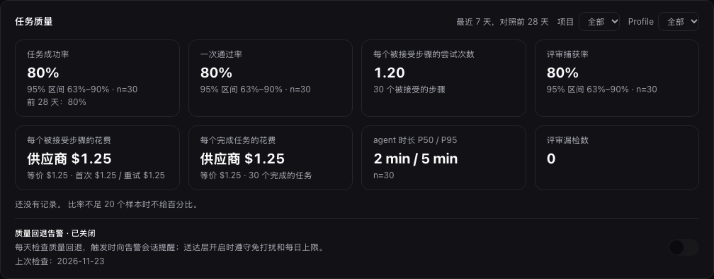
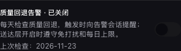

# Task-quality regression alerts

The alerts are off by default. Operator-only `metrics_alerts.get` and `metrics_alerts.update` also generate
`loopercli metrics-alerts get|update`. The home page's task-quality group has the same switch and the last daily
check. Lark and Telegram use the existing dashboard gate alert target; deferred alerts appear as “质量告警” in
the morning brief. No agent tools, prompts, contracts or task dispatch paths change.

## Decisions

- Compare the last seven days against the preceding 28 days after 09:00 in the operator's configured time zone,
  falling back to the server's zone. Each rule requires 20 samples in each window; cost samples are accepted
  steps with known cost in that billing basis. Costs use medians, including earlier failed attempts and child
  runs. Alert-only figures reuse the metric reader's loaded rows; public metric responses stay unchanged.
- The first thresholds come from the task-metrics RFC. Reversible defaults for worsening are drops of
  10/20/30 percentage points, cost increases above 50% / at least 100% / at least 200%, and missed-review multiples
  above 2 / at least 4 / at least 8. A lower or unchanged tier converges for seven days; a judged recovery clears
  the state. Cost state also remembers the firing billing bases, so missing samples cannot prove their recovery.
- Missing attempts are checked hourly, including ongoing tasks, and sent separately once per local date and
  count. Recovery joins the next daily message. These alerts remain `NORMAL`: quiet hours and daily caps apply
  when delivery is enabled. An exemption requires a maintainer decision and is outside this change.
- A session advisory lock covers each check and send; the local daily claim is stored before computing.
  Exceptions are logged, and daily rules try again the next day. A failed send does not advance rule convergence
  state. A missing-attempt send is claimed before sending to avoid duplicate attempts across restarts.
- Migration 1420 widens the current source CHECK, preserving additions from other migrations. Upgrade validation
  happens after commit; the frozen schema baseline is unchanged.

## Local validation

Python 3.11, two pytest workers, a disposable PostgreSQL database: **596 passed, 0 failed, 0 skipped**.
The targeted command is:

```sh
uv run --system-certs --python 3.11 --extra test python -m pytest -q -n 2 \
  tests/test_metrics_alerts.py tests/test_metrics_alerts_db.py \
  tests/test_metrics_alert_figures_db.py tests/test_metrics_alert_source_db.py \
  tests/test_task_metrics.py tests/test_task_metrics_db.py \
  tests/test_api_v1_document.py tests/test_tool_levels.py \
  tests/test_bridge_schema_db.py tests/test_schema_migration_registry_db.py \
  tests/test_proactive_deliveries_store_db.py tests/test_morning_brief_db.py \
  tests/test_morning_brief.py tests/test_delivery_guard_settings.py
```

The fixtures cover 19/20-sample boundaries, both cost bases, the strict cost/missed thresholds, combined messages,
seven-day convergence, worsening, recovery, concurrent services and restart, quiet-hours deferral and the morning
brief label, operator-only API access, and widening after `morning_brief`, `idle_check` and `triage`. Fixed recorded
revisions verify public metric response bytes, unchanged agent source, and home markup without the switch line.

The runtime smoke started `looper serve` with a new database, an isolated runtime root, and an unused loopback port.
With actual outcome and attempt records (20 current, 20 comparison; 50% versus 100% success/first-pass), the switch
was enabled through its authenticated HTTP operation. A separate local script loaded the same configuration and
called `MetricsAlertService.run_once` through `ChannelRegistry.notify` with a local channel stand-in. It captured
one combined message, then zero additional messages on a second tick. The Wilson interval was 29.9%–70.1%.
The server shut down cleanly. No model or real messaging provider was called.

Frontend: 14 targeted Vitest checks and the production build pass. A browser with local API stand-ins checked
1280, 768, 390 and 844-pixel widths, populated/empty/error/unavailable states, keyboard switching, cancellation,
and confirmation with the same session. There was no horizontal overflow or page error.




## Pending real-model validation

None is required by this change: all message text is code-written and model-visible bytes are unchanged.
No paid eval was run; the model budget consumed is $0. Full-suite CI and independent review remain separate.
