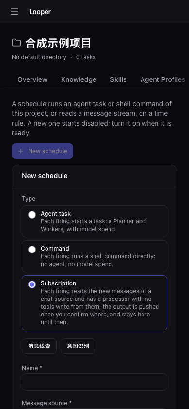

# Event triage run validation

The switch remains off by default. This validates the run and local storage, without Manager handoff or delivery.
All messages, chats and participants below are synthetic.

## Disposable server path

A fresh database and throwaway runtime root ran `looper serve` on a free port. The processor's registered Agent
Profile selected a dedicated Claude Code runtime whose executable was a scripted CLI returning a fixed triage
JSON object. It emitted a tool-less init and a successful result; no real model was called. The interpreter and
imported package were checked to be from the implementation checkout.

Through HTTP, the operator read the event-triage preset, verified that creation was refused while the switch was
off, enabled the switch, created the subscription, confirmed its configuration and fired it manually. Creation
must follow enabling because D1 refuses creation while off. Synthetic events were inserted through the message
stream's ingestion functions and its committed cursor.

Database readback after the run:

| Check | Result |
|---|---|
| Run | `completed`, `extracted`, processor record linked |
| Exact selected window | `[1, 2, 3, 4]`; cursor advanced to `4` |
| Counts, per window message | important `1`, digest `2`, ignore `1`, raised `1`, uncited `0`, dropped `{}` |
| Events and provenance | `4` events, `4` source links |
| Injection marker | The event citing the marked message was flagged |
| Code floor | The uncited unanswered direct message became its own raised digest |
| Handoff and delivery | `0` Manager events; every `manager_event_id` stayed NULL; no delivery |

The existing HTTP run projection returned the count summary and the subscription returned the advanced cursor.
Structured window and counts were verified directly in `subscription_runs`; this change does not add a why API.
The fake CLI's reported cost was zero and is not a real cost measurement. The server was stopped by its recorded
PID, its port closed and the disposable database dropped.

## Dashboard

The actual built dashboard and the disposable server's confirmation were checked in headless Chromium at 390 px.
The panel displayed the private-chat, @-mention, own-message and alert-bot scope; the borrowed $0.005–0.008 per-run
estimate, with triage's expected 10–30% increase; and the storage-only destination. The confirmation action was
enabled and the page had no horizontal overflow or browser errors. The screenshot scrolls the panel to the cost
and destination text. The component was also checked at 768 px, 1280 px and 844 × 390.

## Pending real-model validation

The six `triage_*` windows contain 18 explicitly labeled messages. Run Sonnet with two repetitions only after
approval, and repeat with Haiku if it is the live processor profile. Commands, a $0.24 cap per profile and the
$0.48 combined cap are in [the eval guide](../../../evals/README.md#the-processor-evalsprocessor).
Record the first measured cost and classification metrics in RFC section 9 after the run. No real-model quality
or cost claim is established by this scripted validation.

## Review regression checks

The switch now gates creation and execution. An isolated `looper serve` with a fresh database and throwaway
runtime root refused creation while off, allowed creation and enabling while on, returned `skipped_gate` after
turning the switch off, and accepted disabling and renaming the existing subscription while off. Database
readback confirmed the renamed, disabled schedule and zero events and model records. The server was stopped
and its disposable database dropped.

Both blocking regressions were reproduced with failing PostgreSQL tests before changing the implementation:
subscription disabling returned 400; overlapping event citations lost provenance and dropped a valid event.
The fixed storage test retains every message and context link, flags every event whose citations include an
instruction marker, counts each window message only in its highest category, reads that category first, and
verifies deletion of a shared source removes all derived events. Events with no exclusive counted messages
still retain their citations. Code-floor tests cover alert bots, imported messages, imported replies and replies
inserted later with an earlier send time. Fenced NONE, an omitted `ignored` list and the shared `ITEMS_MAX` cap
are covered too. `extract_counts.none` preserves the explicit NONE reason even when the code floor raises a
message; uncited messages remain counted without individual event rows.

Validation after merging the current base branches and main:

- Python: **486 passed**, no skips, using `-n 2` and a dedicated disposable database. Files:
  `test_extraction_db.py`, `test_extraction_default_off.py`, `test_triage_default_off.py`, `test_triage_run.py`,
  `test_triage_run_db.py`, `test_triage_settings_db.py`, `test_triage_reads_db.py`, `test_api_v1_document.py`,
  `test_tool_levels.py`. Every failing file was rerun to green.
- Dashboard: **62 passed** in `project-schedules.test.tsx`; production build passed with the existing chunk-size
  advisory. The preset button is shown only after the operator switch is confirmed enabled. Off or unavailable,
  it is hidden; existing subscription editing remains available. Headless Chromium checked enabled, disabled
  and unavailable settings at 1280, 768, 390 and 844 × 390, with synthetic HTTP responses and no browser errors.
- The dashboard is the changed entry point. CLI, Telegram and Lark retain the shared schedule-update semantics;
  they need no new control or schema. No real-model calls or manually triggered CI runs were performed.

