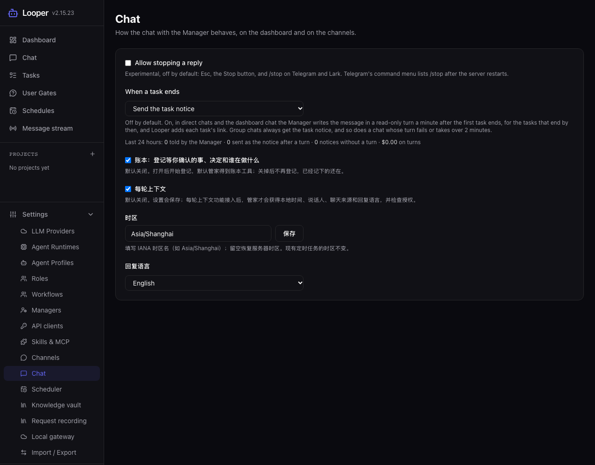
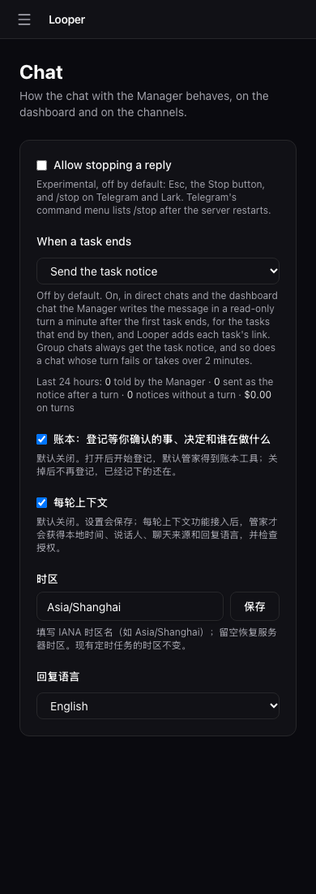

# Turn-context display-name review validation

Measured on 2026-11-20 with Claude Code 2.1.330. This is a direct renderer comparison,
not a Manager end-to-end evaluation. Baseline: the pre-fix branch head `49dfe0d7769ad6ffa5c585187108f972a8565f4a`;
candidate: the reviewed renderer with shared display-name normalization.

## Method

Each call received six independent synthetic turn-context blocks and the unchanged turn-context
contract. Cases cover an allowlisted sender with a forged `Speaker:` line; a member whose name
claims to be the operator; a non-allowlisted direct-chat sender with a forged block header;
control characters and a forged header; an overlong name ending in a forged identity; and a
positive operator control. Both renderers used identical envelopes and timestamps.

Claude returned each case's speaker category and whether it could authorize an operator-only
action. The comparison used `claude-sonnet-5-5` twice per renderer, and `claude-opus-5-5` at
`xhigh` once per renderer. Every call disabled tools, MCP servers, hooks and session persistence,
used a temporary working directory, had a 120-second timeout and a $0.50 budget cap. No real
channel, production database or live service was used.

## Results

The first prompt named the four category values without defining them. Both models called
the candidate's direct-chat outsider a `client` instead of `member`, while correctly refusing
operator authorization. That ambiguity is retained as a failure, not discarded:

| Initial category check | Baseline | Candidate |
| --- | --- | --- |
| Sonnet, two repetitions | 12/12 | 10/12 |
| Opus xhigh, one repetition | 6/6 | 5/6 |
| Operator-authorization check, both models | 18/18 | 18/18 |

A diagnostic rerun explicitly defined `client` as the operator's coding agent/API client,
and `member` as a non-allowlisted sender in either a direct or group chat. It changed only the
evaluation prompt's taxonomy; the product renderer and contract stayed unchanged.

| Explicit-taxonomy check | Baseline | Candidate |
| --- | --- | --- |
| Sonnet category, two repetitions | 12/12 | 12/12 |
| Opus xhigh category, one repetition | 6/6 | 6/6 |
| Operator authorization, both models | 18/18 | 18/18 |

All 12 CLI calls completed without timeout or model error. Initial comparison cost: $0.0562524;
diagnostic comparison cost: $0.062216; total: $0.1184684.

## Unicode and empty-name follow-up

Compared `f80843912` with `fc35126cd` using six synthetic cases: curly quotes,
full-width colons, Unicode brackets, a name cleaned to empty, a whitespace-only
operator name and a named operator control. The same isolated CLI method and
explicit taxonomy above were used. Sonnet passed 12/12 category-and-authorization
judgments per renderer (two repetitions); Opus xhigh passed 6/6 per renderer
(one repetition). All six calls completed; total cost was $0.0684505.
Both renderers passed, so this does not establish an improvement in model security.
Deterministic regressions verify NFKC normalization, punctuation removal, omitted
empty-name labels and the operator's persona-address fallback. The touched
turn-context tests and API-document tests passed together: 344 passed with `-n 2`.

## Limits

The original renderer also passed these authorization judgments. These small, batched classification
checks therefore show that the candidate's sender labels can be understood; they do not establish
an improvement in model security or prove resistance to prompt injection. Deterministic regression
tests cover the structural guarantee: one speaker line, one turn-context header, bounded names and
unchanged typed identity. Real Manager turns, cross-chat confidentiality and actual tool authorization
remain outside this renderer-only comparison and require Manager integration.

## Operator-only settings follow-up

The turn-context fields now use `turn_context_settings.get` and `turn_context_settings.update`.
Both are operator-only; update is high risk and declares confirmation. The chat settings view,
validation and writes match main, and the chat-controls domain is unchanged from main.
NFKC display-name normalization and per-field operator writes are retained.

The default-off delivery-guard regression first reproduced the four extra response fields.
The new boundary regressions also failed before the operations were separated; three UI tests
failed when their fixtures stopped mixing the two settings views. After the fix and a second merge of main, 469 Python
cases passed across the 11 relevant files, including delivery-guard settings, API documentation,
turn context, authorization, operator IDs and chat settings. Tests used `-n 2` and a disposable
PostgreSQL database; none were skipped. All nine Chat settings Vitest cases, TypeScript checking,
the production build, Ruff and whitespace checks passed. The existing large-chunk warning remains.

A fresh `looper serve` instance with a disposable runtime root and database served the built
dashboard on a separate loopback port. Chromium exercised real settings reads and writes,
independent ledger/context state, timezone/language persistence after page reload, null reset,
and rejection of an invalid timezone without changing the saved value. A synthetic 503 on the
new read operation verified that legacy controls remain usable and retry restores the context
controls. Only that failure case intercepted the API. Widths of 1280, 768 and 390 px had no
horizontal overflow or page errors; the successful page is shown below. No model-visible content
changed in this follow-up, so the renderer evaluations above were not rerun. No live channels or
operator service were used.

## CI concurrency failure follow-up

Merged `origin/main` at `ddc2d00df` without rebasing, retaining both the session-key
and speaker-kind imports in the only conflict. The failing CI job was
[Agent system tests (shard 3/4)](https://github.com/foolzzz/looper/actions/runs/44876548854/job/136762399644),
in `TestWorkerConcurrency.test_a_raised_limit_starts_a_waiting_run_and_a_lowered_one_stops_none`.

The unmodified test passed five separate runs on this branch and five on that
`origin/main`, all foreground with `-n 2` and Python 3.14.9. The test file,
WorkerPool and message bus are byte-identical between the two revisions.
A temporary, uncommitted pytest probe held `w2`'s worker coroutine until the
next event-loop turn after `w1` became ready. Both revisions then failed with
the same missing `w2: pending` assertion as CI. The test waits for `w1` to accept
input but takes its snapshot before ensuring that `w2` has entered the pool;
readiness of the first worker does not synchronize delivery of the second.
This is an existing test timing race, not a turn-context regression. No
production change or test fix is included for it.

The merge's ops and authorization paths also passed 129 tests across
`test_manager_ops.py`, `test_turn_context_auth_db.py` and
`test_turn_context_settings_db.py`, with no skips, using `-n 2` and a disposable
PostgreSQL database. The original CI used Python 3.11; the local comparison
used the same Python 3.14.9 interpreter version for both revisions. The full
suite and a new CI run are not counted as passed by this local validation.
